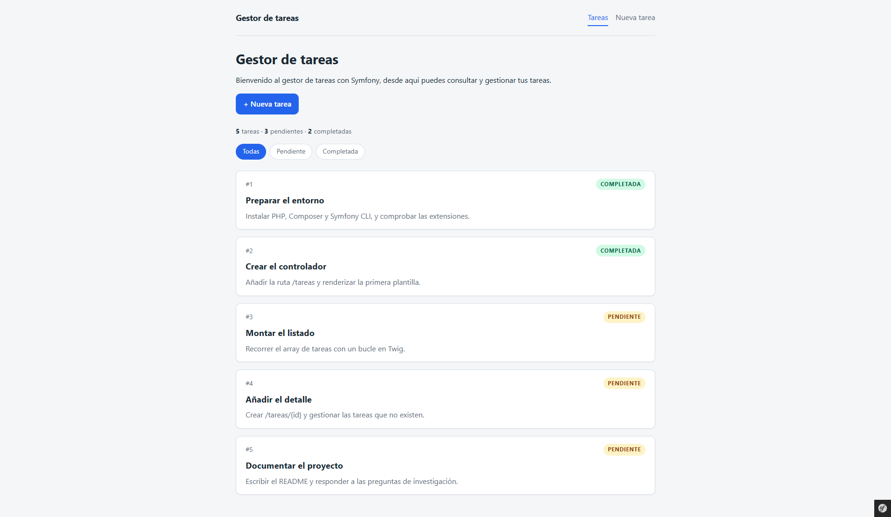
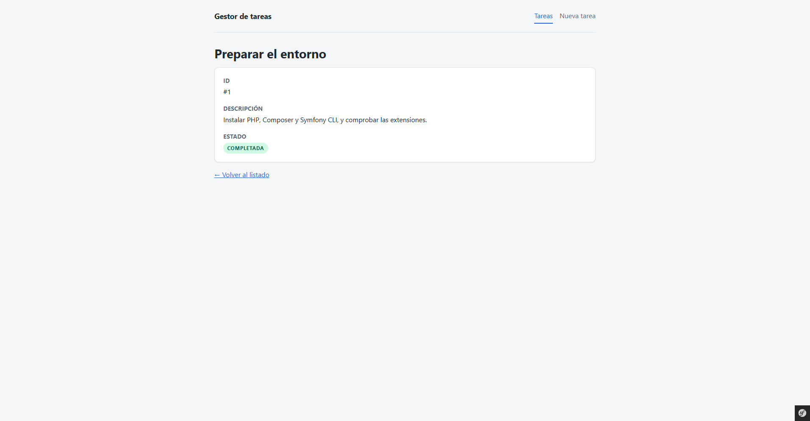
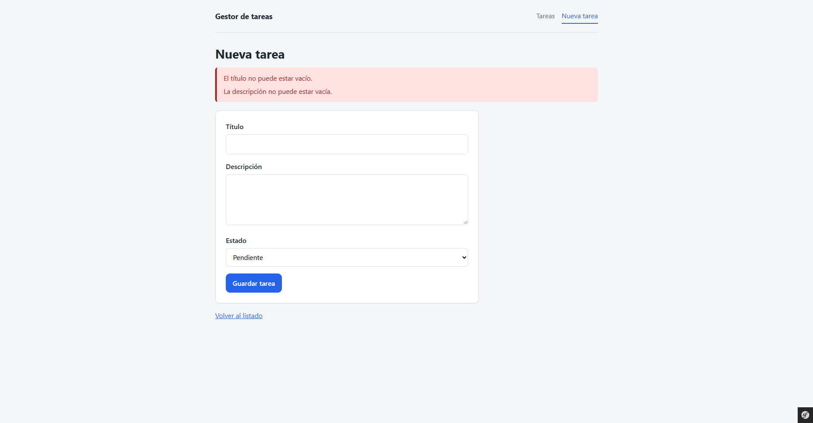
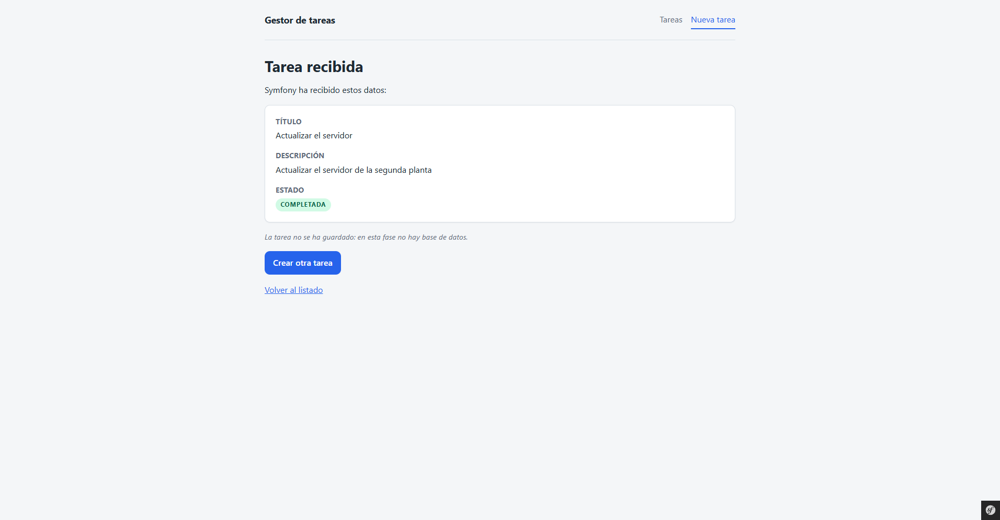
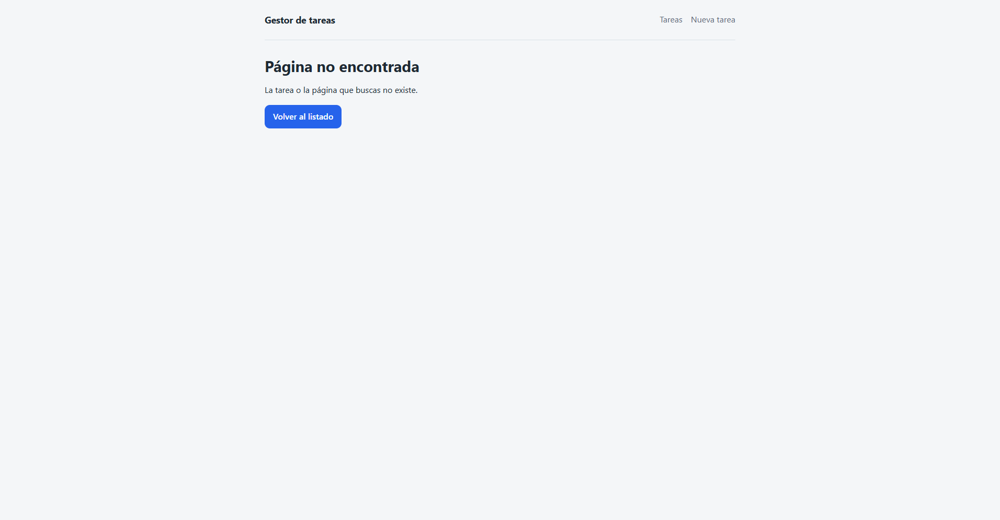

# Gestor de tareas con Symfony

Aplicación web de ejemplo para la **Práctica 04**: un gestor de tareas con listado,
detalle, creación con validación en servidor y una página 404 personalizada.

El proyecto usa **Symfony 8.1**, **PHP 8.4+**, **Twig** y **HTML/CSS**. No hay base
de datos: las tareas viven en un repositorio en memoria, tal y como pide el
enunciado. El enunciado original está en [`enunciado.md`](enunciado.md).

## Funcionalidades

- Listado de 5 tareas con ID, título, descripción y estado.
- Contador de tareas por estado (5 totales, 3 pendientes, 2 completadas).
- Filtro por estado: `?estado=pendiente` y `?estado=completada`.
- Detalle de cada tarea en `/tareas/{id}`.
- Página 404 personalizada cuando la tarea no existe.
- Formulario de creación con validación en el servidor.
- Patrón **PRG** (Post/Redirect/Get) para que recargar no reenvíe el formulario.
- Protección **CSRF** en el formulario.
- Layout común, navegación con enlace activo, badges de estado y diseño responsive.

## Requisitos

- PHP 8.4 o superior con las extensiones `ctype` e `iconv`.
- [Composer](https://getcomposer.org/).
- [Symfony CLI](https://symfony.com/download) (recomendado para arrancar el servidor).

## Instalación y arranque

```bash
composer install
symfony serve -d
```

La aplicación queda disponible en:

```
http://127.0.0.1:8000/tareas
```

Para detener el servidor:

```bash
symfony server:stop
```

Si no tienes Symfony CLI, puedes usar el servidor embebido de PHP:

```bash
php -S 127.0.0.1:8000 -t public public/index.php
```

## Rutas

| Método | Ruta | Nombre | Acción |
|---|---|---|---|
| GET | `/tareas` | `tarea_listado` | Listado, contador y filtro por estado |
| GET | `/tareas/{id}` | `tarea_detalle` | Detalle de una tarea (404 si no existe) |
| GET | `/tareas/nueva` | `tarea_nueva` | Formulario de creación |
| POST | `/tareas/nueva` | `tarea_crear` | Valida los datos y redirige (PRG) |
| GET | `/tareas/confirmacion` | `tarea_confirmacion` | Confirmación con los datos recibidos |

El filtro del listado se pasa por query string:

```
/tareas                       -> todas
/tareas?estado=pendiente      -> solo pendientes
/tareas?estado=completada     -> solo completadas
```

Cualquier otro valor se ignora y se muestran todas.

## Estructura del proyecto

```
src/
├── Controller/
│   └── TareaController.php        Rutas y lógica de cada página
├── Repository/
│   └── TareaRepository.php        Datos en memoria y consultas
└── Kernel.php

templates/
├── base.html.twig                 Layout común: cabecera, menú y bloques
├── tarea/
│   ├── index.html.twig            Listado, resumen y filtros
│   ├── detalle.html.twig          Detalle de una tarea
│   ├── nueva.html.twig            Formulario de creación
│   ├── confirmacion.html.twig     Confirmación tras el PRG
│   └── _estado.html.twig          Partial reutilizable del badge
└── bundles/TwigBundle/Exception/
    └── error404.html.twig         Página 404 personalizada

public/
├── index.php                      Punto de entrada
└── css/app.css                    Hoja de estilos

tests/
└── Controller/TareaControllerTest.php   Tests funcionales (18 tests)
```

## Recorrido de una petición

Ejemplo con `GET /tareas/3`:

1. El **router** hace coincidir la URL con la ruta `tarea_detalle`.
2. Symfony llama a `TareaController::detalle(3)` e inyecta el parámetro `id`.
3. El controlador pide la tarea a `TareaRepository::find(3)`.
4. Si no existe, lanza `createNotFoundException()` y Symfony responde 404.
5. Si existe, `render()` pasa la tarea a `templates/tarea/detalle.html.twig`.
6. Twig genera el HTML final y Symfony lo devuelve como `Response`.

## Validación del formulario

La validación se hace en el servidor, no solo en el navegador:

| Campo | Regla |
|---|---|
| Título | `trim()` y no puede quedar vacío |
| Descripción | `trim()` y no puede quedar vacía |
| Estado | Debe ser `pendiente` o `completada` (`in_array` estricto) |

Los atributos HTML (`required`, etc.) son solo una ayuda visual: se pueden
desactivar desde el navegador, así que la comprobación real siempre está en el
controlador.

## Decisiones de diseño

- **Sin base de datos.** `TareaRepository` encapsula un array constante con las 5
  tareas. Al estar aislado, se puede sustituir por Doctrine más adelante sin
  cambiar los controladores.
- **Validación manual.** No se usa Symfony Form; se leen los datos de
  `$request->request`, se limpian con `trim()` y se validan con `if`. Así se ve
  el recorrido de los datos sin capas intermedias.
- **PRG.** Tras un POST válido se guarda el resultado en sesión y se redirige a
  `GET /tareas/confirmacion`. Recargar la confirmación no reenvía el formulario.
- **CSRF.** El formulario incluye un `_token` generado con `csrf_token('crear_tarea')`
  y el controlador lo comprueba con `isCsrfTokenValid()`. Un POST sin token válido
  no se procesa.
- **404 personalizada.** Se sobrescribe la plantilla de TwigBundle en
  `templates/bundles/TwigBundle/Exception/error404.html.twig`. En `dev` Symfony
  muestra su pantalla de debug; en `prod` se ve la página personalizada.
- **Twig reutilizable.** `base.html.twig` concentra el HTML común y el partial
  `_estado.html.twig` evita repetir el badge en listado, detalle y confirmación.

## Tests

```bash
php bin/phpunit
```

Actualmente: **18 tests y 69 assertions**. Cubren listado, contador, filtros,
detalle, 404, formulario, validaciones, PRG y CSRF.

## Estilo de código

El proyecto sigue el ruleset `@Symfony` de PHP-CS-Fixer:

```bash
php vendor/bin/php-cs-fixer fix
```

## Comprobaciones útiles

```bash
php bin/console lint:twig templates
php bin/console lint:container
php bin/console debug:router
```

## Capturas

Las capturas están en `docs/capturas/`:

### Listado con contador y filtros



### Detalle de una tarea



### Formulario con errores de validación



### Confirmación tras crear una tarea



### Página 404 personalizada



## Preguntas de investigación

Las respuestas a las 8 preguntas del enunciado están en
[`docs/preguntas.md`](docs/preguntas.md).
